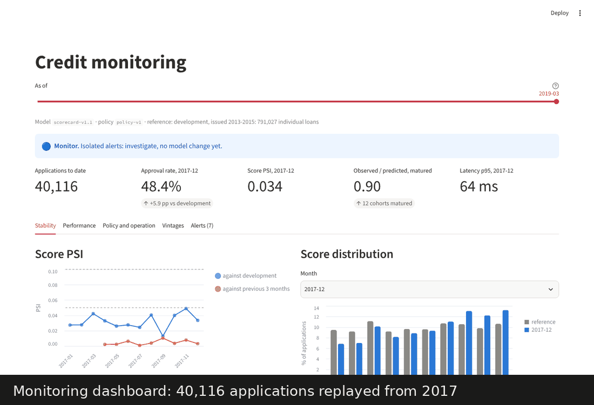
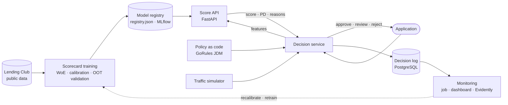

# credit-decisioning-e2e

[](https://github.com/samuelkanneman/credit-decisioning-e2e/actions/workflows/ci.yml)

End-to-end credit decisioning system: scorecard → scoring API → rules engine → monitoring, built on public Lending Club data.

The point is the engineering and the credit policy around a model, not its AUC: a score built to risk standards, served behind a contract, wrapped in a policy versioned as code, monitored as if it were deciding real loans, and replaced through a written promotion process when monitoring says so.



## What it shows

| Question | Answer |
| --- | --- |
| Does the score rank risk on loans it never saw? | Trained on 2013–2015, tested on 2016: AUC 0.672 and KS 24.5%, against 0.578 and 11.7% for the bureau score alone. The bad rate falls from 9.4% in the riskiest decile to 1.0% in the safest, with no inversions. |
| What is the policy worth? | Approving the same 52.4% of applicants as a bureau-score ranking, charge-offs fall from 10.6% to 8.6% and the margin on the amount lent rises from 1.8% to 2.7%: $65k more profit per 1,000 applicants, measured on loans that ran their full term. |
| Where do the cut-offs come from? | Below a score of 580 every 5-point slice loses money; from 595 every slice still makes money with 34% more defaults. In between, a reviewer decides. Each rule cites its number in [the policy](docs/policy.md). |
| What happened in "production"? | Replaying 2017, monitoring said **recalibrate, not retrain**: the ranking held, but loans went bad 1.27 times as often as predicted. The recalibrated `scorecard-v1.1` met every preregistered criterion (observed / predicted 1.015, no decision changed) and was promoted. |
| Can it see a change in who applies? | A riskier channel injected from July cut approval by 10 points and fired a knock-out 58% more often, while score PSI against development *fell*: the new applicants pulled the distribution back towards development. A second, rolling reference caught it. |

Gradient boosting on the same variables buys one point of AUC; the scorecard keeps a points table, reason codes and a pure-Python runtime for that price. Details in the [model card](docs/model_card.md).

## Architecture



Four containers (PostgreSQL, scoring API, decision service, dashboard) start with one command. CI lints, tests, runs the whole pipeline on synthetic data, builds the images, starts the stack, sends decisions, replays traffic and checks what lands in the logs.

## Quickstart

### Run the stack

Requires Docker. The trained scorecard and the policy are in the repository, so no data is needed.

```bash
make up       # PostgreSQL, scoring API (:8000/docs), decision service (:8001/docs), dashboard (:8501)
make smoke    # checks the scoring API and the decision service end to end
```

Ask for a decision:

```bash
curl -s localhost:8001/decide -H 'Content-Type: application/json' -d '{
  "application_id": "demo-0002", "loan_amnt": 30000, "term": 36, "purpose": "credit_card",
  "annual_inc": 60000, "emp_length": 6, "home_ownership": "MORTGAGE", "dti": 12.0,
  "fico": 735, "acc_open_past_24mths": 2, "inq_last_6mths": 0, "mths_since_recent_inq": null,
  "mo_sin_rcnt_tl": 18, "mths_since_recent_bc": 30, "mo_sin_old_rev_tl_op": 220,
  "bc_open_to_buy": 20000, "tot_hi_cred_lim": 250000}'
```

```json
{
  "application_id": "demo-0002",
  "decision": "APPROVE", "requested_amount": 30000.0, "approved_amount": 24000.0,
  "reasons": [{"source": "policy", "code": "L1",
               "description": "Amount limited to 40% of annual income for this risk band"}],
  "score": 635, "pd": 0.0089, "band": "A", "arm": "champion",
  "model_version": "scorecard-v1.1", "policy_version": "policy-v1",
  "trace": {"knockout": null, "decision_rule": "S3", "limit_rule": "L1", "max_loan_to_income": 0.4}
}
```

A rejection lists the policy rule first and then, when the score drove it, the variables that cost the applicant the most points. Every decision is written to PostgreSQL before the answer is returned, with the model version, the policy version and hash, and the champion or challenger arm.

The scoring API on its own (`POST :8000/score`) returns score, PD, band and reason codes; a value outside the ranges the model was trained on is a 422, never a score. Measured on the stack with 3,000 real 2017 applications: scores identical to training, decisions identical to the offline policy, 9.4 ms at p95 for a full decision.

### Replay 2017 and monitor it

Requires the real data (`make data`, below) and the running stack.

```bash
make simulate              # 10% of 2017, month by month, through the decision service
make simulate DRIFT=broker # the same, with a riskier channel from July 2017
make monitor               # docs/monitoring_report.md: alerts and recommendation as of 2019-03
make evidently             # monthly Evidently drift reports (HTML) in build/monitoring/evidently
```

The dashboard at `http://localhost:8501` reads the decision log and lets you move the "as of" month: inputs update as applications arrive, performance appears only once a cohort has matured, and only for booked loans.

### Rebuild the model

Requires [uv](https://docs.astral.sh/uv/) and `make`.

```bash
make setup
make test
make demo     # whole pipeline on synthetic data, no credentials; output in build/demo
```

To train on the real data you need a Kaggle account and an [API token](https://www.kaggle.com/docs/api), exposed as `KAGGLE_API_TOKEN` (or `KAGGLE_USERNAME` and `KAGGLE_KEY` for a legacy key):

```bash
make data     # downloads from Kaggle (~650 MB), verifies SHA-256, builds parquet
make audit    # regenerates docs/data_audit.md
make dataset  # population, target, split, features, data contract check
make binning  # monotonic WoE bins, IV, stability, variable selection
make train    # scorecard, challenger, out-of-time validation, model export, MLflow
make policy-analysis  # cut-off curve, swap-set, knock-outs, limits, reject inference
make policy-diff      # how many decisions a change in policy/ moves
make recalibrate CANDIDATE=scorecard-v1.2  # same points, PD refitted
make promote CANDIDATE=scorecard-v1.2      # compare with the champion; promote if every criterion passes
```

Loan data is never committed. `make data` fetches it from the source and checks it against the hashes in [`data_manifest.json`](data_manifest.json). The synthetic data is random by construction and supports no conclusion about credit risk; it exists so tests and CI run without the real files.

## Project phases

| Phase | Deliverable | Status |
| --- | --- | --- |
| 0. Foundations | Repo skeleton, reproducible data pipeline, CI | Done |
| 1. Score | Calibrated scorecard, LightGBM challenger, out-of-time validation | Done |
| 2. Scoring API | Containerised `/score` with reason codes | Done |
| 3. Policy | Cut-off analysis, swap-set, reject inference, rules engine | Done |
| 4. Monitoring | Production traffic simulator and dashboard | Done |
| 5. MLOps | End-to-end CI, model lifecycle and promotion | Done |


## How it is built

The project follows [data-science-harness](https://github.com/samuelkanneman/data-science-harness), my method for doing data science with coding agents: an explicit data contract, fit / selection / evaluation kept apart, experiments preregistered before they run, and metrics with one canonical definition. The rules that apply here are in [`AGENTS.md`](AGENTS.md).

## Design decisions

- [Model card](docs/model_card.md) and the [model lifecycle](docs/model_lifecycle.md): how a candidate is compared with the champion and promoted
- [ADR-001: Dataset and data access](docs/adr/001-dataset.md)
- [ADR-002: Target definition and temporal split](docs/adr/002-target-and-split.md)
- [ADR-003: Scoring runtime and model artifact](docs/adr/003-scoring-runtime.md)
- [ADR-004: Profitability, loss given default and the stress case](docs/adr/004-profitability-and-lgd.md)
- [Credit policy](docs/policy.md) and the [analysis](docs/policy_analysis.md) behind every cut-off
- [ADR-005: Rules engine and decision service](docs/adr/005-rules-engine.md)
- [ADR-006: Monitoring design](docs/adr/006-monitoring.md) and the [thresholds and retraining criteria](docs/retraining_criteria.md)
- Monitoring reports: [2017 as it happened](docs/monitoring_report.md), [with an injected channel](docs/monitoring_report_drift.md), [after recalibration](docs/monitoring_report_v1.1.md)
- [Binning and variable selection](docs/binning.md)
- Experiments, each preregistered before it ran: [001, scorecard and challenger](docs/experiments/001-scorecard.md) · [002, recalibration](docs/experiments/002-recalibration.md) and its [promotion report](docs/promotion_scorecard-v1.1.md)
- [Data audit](docs/data_audit.md): cohort maturity and first look at the target
