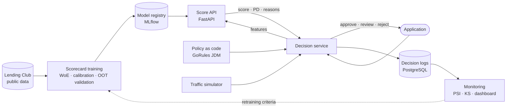

# credit-decisioning-e2e

[](https://github.com/samuelkanneman/credit-decisioning-e2e/actions/workflows/ci.yml)

End-to-end credit decisioning system: scorecard → scoring API → rules engine → monitoring, built on public Lending Club data.

The point of this repository is the engineering and the credit policy around a model, not the model's AUC: how a score is built to risk standards, served, wrapped in a policy that is versioned as code, and monitored once it is making decisions.

> **Status: work in progress.** Phase 0 is done; later phases are planned in [`docs/roadmap.md`](docs/roadmap.md) (Spanish).

## Architecture



## Roadmap

| Phase | Deliverable | Status |
| --- | --- | --- |
| 0. Foundations | Repo skeleton, reproducible data pipeline, CI | Done |
| 1. Score | Calibrated scorecard, LightGBM challenger, out-of-time validation | Planned |
| 2. Scoring API | Containerised `/score` with reason codes | Planned |
| 3. Policy | Cut-off analysis, swap-set, reject inference, rules engine | Planned |
| 4. Monitoring | Production traffic simulator and dashboard | Planned |
| 5. MLOps | End-to-end CI with `docker compose` | Planned |

## Quickstart

Requires [uv](https://docs.astral.sh/uv/) and `make`.

```bash
make setup
make sample   # synthetic data with the real schema: no credentials needed
make test
```

To work with the real data you need a Kaggle account and an [API token](https://www.kaggle.com/docs/api), exposed as `KAGGLE_API_TOKEN` (or `KAGGLE_USERNAME` and `KAGGLE_KEY` for a legacy key):

```bash
make data     # downloads from Kaggle (~650 MB), verifies SHA-256, builds parquet
make audit    # regenerates docs/data_audit.md
```

Data is never committed. `make data` fetches it from the source and checks it against the hashes in [`data_manifest.json`](data_manifest.json). The synthetic sample is random by construction and supports no conclusion about credit risk; it exists so tests and CI run without the real files.

## Design decisions

- [ADR-001: Dataset and data access](docs/adr/001-dataset.md)
- [ADR-002: Target definition and temporal split](docs/adr/002-target-and-split.md)
- [Data audit](docs/data_audit.md): cohort maturity and first look at the target
